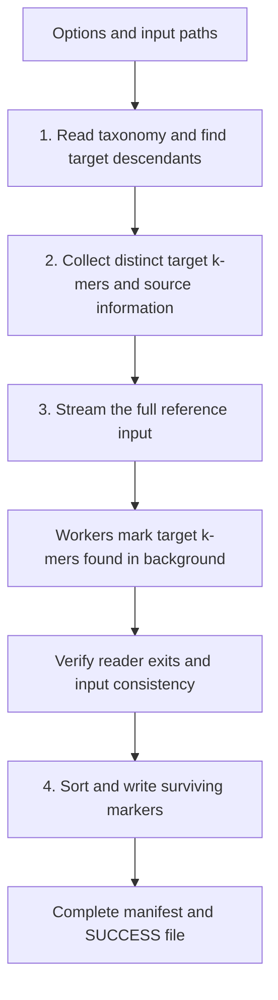
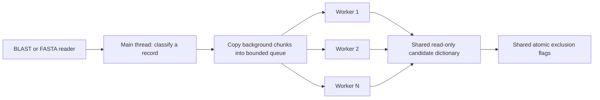

# Understanding CladeMers

**A guided tour from the biological question to the C++ implementation**

Written for a returning programmer: you can understand this program without first learning all of C++. Learn the biological operation, follow one small example, then connect each piece of syntax to the job it performs.

This guide explains [clademers.cpp](clademers.cpp), **version 0.7.0**, as inspected on November 21, 2026. The inspected file has 1,538 lines and SHA-256 `902ae8ce977bbfb4a2f361abfa00fae5f15a4e27ef10cfceb4c7ddbcb1d08076`. Source links open the current repository files; search for the named functions. This is a historical guide: use the README for current input, reporting, build, and checkpoint behavior.

The central algorithm dates to **0.1.0**. Later versions added BLAST taxonomy input, FASTA input, gzip support, and richer progress reporting. This guide describes those additions through 0.7.0; subsequent releases also add checkpoint recovery and descendant reports.

## Contents

1. [The whole program in one idea](#1-the-whole-program-in-one-idea)
2. [A complete example small enough to do by hand](#2-a-complete-example-small-enough-to-do-by-hand)
3. [The source map and a useful reading order](#3-the-source-map-and-a-useful-reading-order)
4. [The C++ vocabulary you need](#4-the-c-vocabulary-you-need)
5. [Following main and run](#5-following-main-and-run)
6. [Taxonomy and the meaning of target](#6-taxonomy-and-the-meaning-of-target)
7. [How DNA becomes an exact numerical key](#7-how-dna-becomes-an-exact-numerical-key)
8. [How candidates remember their source](#8-how-candidates-remember-their-source)
9. [Parallel background scanning](#9-parallel-background-scanning)
10. [Reading files and running other programs](#10-reading-files-and-running-other-programs)
11. [Results, progress, and failure handling](#11-results-progress-and-failure-handling)
12. [Headers, libraries, programs, and compilation](#12-headers-libraries-programs-and-compilation)
13. [Memory, speed, and the limits of the result](#13-memory-speed-and-the-limits-of-the-result)
14. [Learn it by running small experiments](#14-learn-it-by-running-small-experiments)
15. [Function and type reference](#15-function-and-type-reference)
16. [A practical study sequence](#16-a-practical-study-sequence)

## 1. The whole program in one idea

CladeMers asks:

> Which exact DNA words occur in at least one reference assigned to my target lineage, and never occur in any of the background references I supplied?

A DNA word of length `k` is a **k-mer**. With `k = 42`, every word contains exactly 42 bases.

Define `K(sequence)` as the set of usable k-mers in a sequence, with each word and its reverse complement represented by the same canonical word. Then:

```text
T = union of K(sequence) over records with any target assignment
B = union of K(sequence) over records that are not exclusively target
result = T minus B
```

**Union** means “collect all distinct members.” **Set difference** means “keep the members of the first set that are absent from the second.” A sequence with mixed target/background assignments contributes to both sets, so its k-mers cannot survive.

This does not require a marker to occur in every placozoan. One target occurrence is enough to nominate it. One background occurrence is enough to disqualify it.

### The key implementation decision

The program stores `T` in memory. It does **not** construct the enormous background set `B` in memory. Instead, it reads background sequences, examines each word, and marks matching members of `T` as excluded.

```text
Build a dictionary of target words.
For every background word:
    if the word is in the dictionary:
        mark that dictionary entry as excluded.
Write every dictionary entry that was never marked.
```

That is the central algorithm. The rest of the program makes the inputs trustworthy, the representation exact, the scan efficient, and the result traceable.

### The four stages



If your Markdown viewer does not draw Mermaid diagrams, read the boxes in arrow order. The same sequence is implemented by `run()`.

### What “exact” means here

Every accepted k-mer is represented by all of its bases. Hashes help find candidates quickly, but hashes alone never decide sequence equality. There is no alignment score, allowed mismatch, or approximate matching threshold.

Exactness is about comparison within the supplied references. It does not establish that a marker is absent from every organism on Earth, and it cannot repair contamination or incorrect taxonomy in the reference data.

## 2. A complete example small enough to do by hand

Use `k = 3` so the words fit on the page. Real runs can use `k = 42`; the rules are identical.

Suppose we have these records:

| Record | Assignment | DNA |
| --- | --- | --- |
| target_one | target | `ACGTA` |
| target_two | target | `AAACC` |
| background_one | background | `TACG` |

### First, find the windows

For `ACGTA`, slide a window three bases wide:

```text
ACGTA
ACG      start 0
 CGT     start 1
  GTA    start 2
```

For an uninterrupted sequence of length `L`, the number of windows is `max(0, L - k + 1)`. That counts occurrences, not distinct sequences.

### Next, make orientation irrelevant

A reverse complement reverses the word and swaps `A ↔ T` and `C ↔ G`. The **canonical** word is the alphabetically smaller of the forward word and its reverse complement.

| Forward word | Reverse complement | Canonical word |
| --- | --- | --- |
| `ACG` | `CGT` | `ACG` |
| `CGT` | `ACG` | `ACG` |
| `GTA` | `TAC` | `GTA` |
| `AAA` | `TTT` | `AAA` |
| `AAC` | `GTT` | `AAC` |
| `ACC` | `GGT` | `ACC` |

The two target sequences therefore nominate five distinct canonical words:

```text
T = {AAA, AAC, ACC, ACG, GTA}
```

Notice that the `ACG` and `CGT` occurrences contribute just one dictionary entry.

### Finally, subtract background

`TACG` supplies the windows `TAC` and `ACG`, which canonicalize to `GTA` and `ACG`.

```text
B      = {ACG, GTA}
result = {AAA, AAC, ACC}
```

The output is sorted, so these three markers are written in the order shown.

Three changes illustrate important policies:

- Add background `TTT`: it canonicalizes to `AAA`, so `AAA` disappears too.
- Change a target sequence to `AANACC`: no window can cross the `N`; only the uninterrupted segments can supply words.
- Assign `target_two` both a target taxid and a background taxid: its words are nominated and then excluded.

The low-complexity word `AAA` survives the original example. CladeMers does not apply a separate low-complexity filter.

## 3. The source map and a useful reading order

The file is organized so definitions generally appear before their use. Execution, however, starts at the bottom in `main()`.

| Source location | Job | Read for |
| --- | --- | --- |
| [Includes and helpers](clademers.cpp) | Imports, constants, small parsing functions | Dependencies and vocabulary |
| [1. Options and progress](clademers.cpp) | Validate command-line choices; report work | User interface |
| [2. Process](clademers.cpp) | Start external programs and check their results | Operating-system interaction |
| [3. Taxonomy and readers](clademers.cpp) | Read text/binary inputs, fingerprint them, resolve ancestry | Input integrity and lineage membership |
| [4. K-mers](clademers.cpp) | Encode, canonicalize, and decode DNA words | The numerical core |
| [5. Records](clademers.cpp) | Translate BLAST/FASTA data into a common form | Biological classification |
| [6. Scanner](clademers.cpp) | Share background work among threads | Performance and concurrency |
| [7. Outputs](clademers.cpp) | Write the manifest and helper output | Reproducibility |
| [8. run and main](clademers.cpp) | Connect all the pieces | Overall control flow |

For a first reading, use this order:

```text
main → run → Record/classify_record → Kmer/each_kmer
     → Source/Origin/Candidates → Scanner
     → Taxonomy → Process/TextInput → progress and output helpers
```

On the first pass through `run()`, treat a function call as a labeled box. You can understand “read taxonomy” before understanding every line that implements it.

## 4. The C++ vocabulary you need

### Names, types, and values

```cpp
using Taxid = std::uint32_t;
namespace fs = std::filesystem;
constexpr std::size_t CHUNK_BASES = 1024 * 1024;
```

`using` gives an existing type a convenient name. A `Taxid` is an unsigned 32-bit integer, not a new kind of object with special behavior. `fs` is a shorter spelling of the filesystem namespace. `constexpr` makes this chunk-size value usable as a compile-time constant.

`std::` identifies names supplied by the C++ standard library. `std::uint64_t` is an unsigned 64-bit integer. `std::size_t` is an unsigned type used for object sizes and container indices; it is normally 64 bits on the target machines, but that is a platform property.

`auto` asks the compiler to infer a type from the initializer. It does not make C++ dynamically typed. Once inferred, the variable has a fixed type.

### Structs and classes

```cpp
struct Origin {
    std::size_t source, position, index;
    bool reverse;
};
```

A `struct` bundles related values. This one remembers where a candidate came from and which exclusion flag belongs to it.

A `class` can bundle values and functions in the same way. The main language distinction here is default access: members of a `struct` start public; members of a `class` start private. Both can have constructors, methods, and destructors.

`public:` marks operations callers may use. Internal members often end in `_`, such as `queue_`. That underscore is a naming convention, not special syntax.

### Values, references, and pointers

| Spelling | Read it as | Why this program uses it |
| --- | --- | --- |
| `Kmer key` | A value, copied when necessary | Small DNA keys are cheap to copy |
| `Kmer& key` | A reference to an existing object | Change that object without making a separate copy |
| `const Kmer& key` | A reference that cannot modify the object through this name | Inspect a key without copying it |
| `const Kmer* key` | A pointer to a key that may be inspected | Keep addresses of existing entries for sorting |
| `nullptr` | No object is pointed to | Optional mapping or process state |
| `object.member` | A member of an object | `record.sequence` |
| `pointer->member` | A member through a pointer | `mapping->entries` |

An `&` in a declaration means reference. An `&` in `x & mask` means bitwise AND. The same symbol has different meanings in different grammatical positions.

Similarly, `*` can introduce a pointer, dereference one, or multiply numbers. Read the surrounding expression.

### Owning a string versus borrowing one

`std::string` owns text storage. `std::string_view` refers to text stored somewhere else, using an address and a length.

`Record::sequence` is a view into the current BLAST line or FASTA sequence buffer. This avoids copying a potentially huge sequence merely to classify it. It must be consumed before that buffer changes. When work is sent to another thread, `Scanner::add()` makes an owning `std::string` for the queued chunk.

This lifetime rule is essential: **a view does not keep its source text alive**. The C++ draft describes string views as references to contiguous character sequences; newer draft features are not all available in this C++17 program. [String-view specification](https://eel.is/c++draft/string.view)

### Containers: the program's main storage tools

| Container | Everyday meaning | CladeMers example |
| --- | --- | --- |
| `std::vector<T>` | A growable array of `T` values | Sources, taxonomy nodes, workers, retained pointers |
| `std::array<T, N>` | An array with a fixed size | Read buffers and four parsed BLAST fields |
| `std::unordered_set<T>` | A collection of distinct keys | Target taxids |
| `std::unordered_map<K,V>` | A dictionary from key to value | K-mer → provenance |
| `std::deque<T>` | A queue-friendly sequence with access at both ends | Pending background chunks |

An unordered container does not promise iteration in sorted order. “Unordered” does not mean approximate: key equality can still be exact.

An **iterator** is an object used to traverse a container. `begin()` points to its first element; `end()` is the position just after its last element. Comparing `find(key)` with `end()` tells you whether the lookup found something.

For a map entry, `entry.first` is the key and `entry.second` is the associated value.

### Functions, lambdas, and templates

This is a regular function:

```cpp
int base_code(char base);
```

It takes one character and returns an integer. The definition includes its body in braces.

This is a **lambda**, a function written directly where it is needed:

```cpp
auto collect_target = [&](const Record& record) {
    // Work using record and variables in the enclosing function.
};
```

`[&]` lets the lambda refer to surrounding variables by reference. In `run()`, that includes the candidate table and counters. `[this]`, used when starting workers, captures the pointer to the current `Scanner` object. A capture is not a copy of the whole program state.

`template<class Function>` lets a function accept different callable types. `each_kmer()` takes a callback named `consume`: it discovers windows, then lets its caller decide what to do with each one.

The target pass supplies “insert this word.” A background worker supplies “look for this word and mark it.” One traversal implementation supports both jobs.

### Constructors, destructors, and ownership

A **constructor** initializes an object. A **destructor**, spelled with `~`, cleans it up when its lifetime ends.

```cpp
~Scanner() { cancel(); }
```

This ensures remaining worker threads are stopped and joined when a scanner is destroyed. `~Process()` closes its pipe and terminates/reaps an unfinished child.

This pattern is called **RAII**: Resource Acquisition Is Initialization. Its useful meaning is “tie a resource's cleanup to an object's lifetime.” Files, locks, subprocesses, and memory have owners with cleanup behavior.

`std::unique_ptr<T>` is an owning pointer with one owner. It frees its object automatically. `std::unique_ptr<std::atomic<bool>[]>` owns an array. By contrast, a raw pointer in the retained-marker vector borrows an entry owned by the candidate map.

`std::move(x)` allows another object to take resources from `x`. It is a cast enabling move operations, not a promise that bytes are physically moved. Moving a queued string usually transfers its allocation instead of copying all its DNA characters. The source object remains valid, but its contents should not be assumed unchanged.

### Other syntax worth recognizing

| Syntax | Meaning here |
| --- | --- |
| `value ? a : b` | Choose `a` if `value` is true, otherwise `b` |
| `for (const auto& item : collection)` | Visit each item without copying or modifying it |
| `std::optional<T>` | Either a `T` value or no value; used for unknown totals |
| `std::nullopt` | The empty state of an optional |
| `Type{...}` | Initialize an object with braces |
| `= delete` | Forbid an operation, such as copying a resource-owning `Process` |
| `explicit` | Prevent unintended implicit construction from another value |
| `static_cast<T>(x)` | Request a specified type conversion |
| `reinterpret_cast<char*>(...)` | View raw storage through a character pointer for byte I/O |
| `const_cast<char*>(...)` | Adapt constness for the POSIX argument interface; it is not permission to modify immutable text |
| `operator==`, `operator<` | Define equality and ordering for a custom type |
| `operator()` | Make an object callable like a function, as with `KmerHash` |
| `R"(...)"` | A raw string literal; convenient for multiline help text |
| `0x...`, `ULL`, `64U` | Hexadecimal literal, unsigned-long-long suffix, unsigned suffix |
| `[[noreturn]]` | Declare that `fail()` never returns normally |

### Errors are exceptions

`fail(message)` throws a `std::runtime_error`. A `try` block contains operations that might throw; a matching `catch` handles the failure. Throwing unwinds the call stack and runs destructors for fully constructed local objects.

`throw;` inside a catch rethrows the original exception. Worker-thread exceptions need extra handling because they do not automatically jump to the main thread; `Scanner` stores and rethrows them explicitly.

## 5. Following main and run

Start at [main()](clademers.cpp). Its job is small:

```text
If no arguments or a help request: print help and return 0.
If a version request: print version and return 0.
Otherwise: parse options, then run the workflow.
If an exception escapes: print an error and return 1.
```

An exit code of zero means successful termination. A nonzero exit code allows a shell or scheduler to recognize failure. It is separate from the text in a log.

### Options describe the run

[Options](clademers.cpp) stores paths, executable names, the target taxid, `k`, worker count, and progress interval. [parse_options()](clademers.cpp) rejects repeated options, missing values, incompatible modes, and out-of-range integers.

The expression:

```cpp
options.database.empty() == options.fasta.empty()
```

is true if both inputs are empty **or** both are supplied. Both cases are invalid because exactly one sequence source must be chosen.

`number()` builds an integer digit by digit and checks for overflow before multiplying by ten. This prevents a huge input from silently wrapping into a different, apparently valid value. `taxid_number()` adds the permitted taxid range.

### run is the orchestration function

[run()](clademers.cpp) owns the important objects, so their lifetimes cover all the stages that need them.

1. Create a new output directory and save a `running` manifest.
2. Construct `Taxonomy`; write the selected taxids.
3. Obtain BLAST metadata, or load the optional FASTA taxid map.
4. Construct the candidate map and collect target words.
5. Save the exact target row, base, and candidate counts.
6. Construct `Scanner`, then stream the complete reference input.
7. Wait for all workers and verify the inputs.
8. Collect unexcluded entries, sort them, and write FASTA/TSV.
9. Save final counts and status, then publish the `SUCCESS` sentinel.

The directory must be new even if an existing directory is empty. This avoids confusing previous artifacts with the new run. The parent directory must already exist.

There are two crucial local callbacks in `run()`:

| Callback | When called | Action |
| --- | --- | --- |
| `collect_target` | First pass | Accept records with `any_target`; store distinct words and their first source |
| `scan_background` | Second pass | Count every row; send records without `only_target` to workers |

FASTA and BLAST input both supply `Record` objects to these callbacks. This is why adding FASTA support did not require inventing a different k-mer algorithm.

## 6. Taxonomy and the meaning of target

### A taxid is a position in a tree

Taxonomy records say “this taxid has this parent.” Membership in a lineage follows the parent chain. Scientific names are labels; numerical ancestry determines membership.

For a miniature example:

```text
1 root
└── 33208 Metazoa
    ├── 10226 Placozoa       ← chosen target
    │   └── 10227           ← included descendant in the bundled fixture
    └── 9606                ← outside the target
```

The fixture is a teaching tree. Use the actual supplied taxonomy for scientific assignments.

### How Taxonomy builds the target set

The [Taxonomy constructor](clademers.cpp) accepts either NCBI dump files or the BLAST SQLite/binary taxonomy files. Both routes produce a common vector of nodes.

It then:

1. Sorts nodes by taxid.
2. Uses binary search (`std::lower_bound`) to locate every parent.
3. Rejects missing parents, duplicate taxids, and a missing requested target.
4. Allows self-parenting only for root taxid 1.
5. Follows parent links to determine whether each node lies inside the target subtree.
6. Stores the included taxids in `targets`, an unordered set used for fast membership checks.

Each temporary node has a state: `0` means unseen, `1` means on the current path, and `2` means resolved. Encountering state `1` again indicates a cycle. Reusing the result at a state-`2` node avoids repeatedly tracing the same ancestors. This reuse is **memoization**.

The traversal uses a vector as an explicit path instead of recursively calling itself. That avoids exhausting the call stack on unusually deep or malformed input. After parent lookup, the resolution walk visits links a bounded number of times rather than repeatedly walking every path to root.

### Two flags express the classification policy

[classify_record()](clademers.cpp) sets:

- `any_target`: at least one reported taxid belongs to the target subtree.
- `only_target`: all required reported assignments are known and inside the subtree.

| Assignments on a record | `any_target` | `only_target` | Candidate pass | Background pass |
| --- | --- | --- | --- | --- |
| Target only | true | true | Include | Skip subtraction |
| Background only | false | false | Skip | Scan |
| Target and background | true | false | Include | Scan |
| Target and unknown | true | false | Include | Scan |
| Unknown only | false | false | Skip | Scan |

`0`, `N/A`, and a missing principal assignment represent unknown information. A positive taxid absent from the target set also counts as outside the target. The program does not apply `merged.dmp` repairs.

BLAST has principal taxids and optional leaf taxids. An absent leaf list (`N/A`, `0`, or empty) is allowed if the principal assignment is valid and target-only. A non-target principal assignment is not overridden by target-only leaves. Thus, classification is deliberately conservative.

### Why every exported defline matters

BLAST can associate multiple definition lines with a sequence. A sequence that appears target-associated in one row can be background-associated in another. The full export is processed without `-target_only`, so a background annotation can exclude it.

The initial BLAST target query receives the explicit `target_taxids.txt` and `-no_taxid_expansion`. CladeMers has already expanded the subtree using its selected taxonomy; it does not ask BLAST to independently expand it again.

For that reason, `target_defline_rows` is a count of accepted export rows, not a guaranteed count of unique DNA sequences. It also includes accepted rows that yield no usable k-mer because they are too short or contain no valid window.

## 7. How DNA becomes an exact numerical key

The core is [Kmer through decode()](clademers.cpp).

### Two bits per base

Four possible bases need two bits:

| Base | Integer | Binary |
| --- | --- | --- |
| A | 0 | `00` |
| C | 1 | `01` |
| G | 2 | `10` |
| T | 3 | `11` |

For example, `ACG` becomes `00 01 10`, the integer 6. This is a reversible encoding of the sequence. It is not a hash.

One 64-bit integer can hold 32 bases. A 42-mer needs **84 bits**, so the program stores two 64-bit words:

```cpp
struct Kmer {
    std::uint64_t high = 0, low = 0;
};
```

`low` contains the least significant 64 bits; `high` contains the remaining bits. At `k = 42`, only the lowest 20 bits of `high` are used. At `k = 64`, all 128 bits are used. `k` belongs to the run, so it does not need to be stored separately in each key.

### Rolling forward one base

You could build a new substring at every position. Instead, [each_kmer()](clademers.cpp) updates the encoding already in hand.

Conceptually, appending a base is:

```text
new_word = (old_word shifted left by 2 bits) OR new_base
keep only the lowest 2*k bits
```

For the two-word representation, the actual forward update is:

```cpp
forward.high = ((forward.high << 2) | (forward.low >> 62)) & mask_high;
forward.low = ((forward.low << 2) | static_cast<unsigned>(base)) & mask_low;
```

Read it in order:

1. Shift the high word left to make room.
2. Bring over the two bits that are about to leave the top of the old low word.
3. Apply the high mask to discard bits outside the window.
4. Shift the low word and add the new base at its bottom.
5. Apply the low mask.

The high update happens first because it needs the **old** low word.

For a one-word toy calculation, sliding `ACG` to `CGT` at `k = 3` is:

```text
ACG = 000110 = 6
shift left 2:       011000 = 24
add T (binary 11):  011011 = 27 = CGT
mask to 6 bits:     011011
```

Sliding once more to `GTA` produces `1101100` before masking; keeping six bits leaves `101100`, which encodes `GTA`.

`<<`, `>>`, `|`, `&`, and `^` mean bit shifts, bitwise OR, AND, and XOR. They operate on individual bits, unlike logical `&&` and `||`.

### Why low_bits has a special case

`low_bits(n)` produces a mask with its lowest `n` bits set to one. A common expression is `(1 << n) - 1`, but shifting a 64-bit value by 64 is invalid in C++.

The code handles `n == 64` separately with `UINT64_MAX`. This is one of the details that makes the `k = 32`, `33`, and `64` boundaries worth testing.

### Maintaining the reverse complement

The reverse-complement window is updated at the same time. It shifts right by two, and the complement of the new forward base is inserted at the high end of the used window.

Because of the chosen encoding, complementing a base is simply:

```text
complement = 3 - base
A: 3 - 0 = 3 → T
C: 3 - 1 = 2 → G
```

The insertion position is `2*k - 2`. A branch chooses whether that position lies in `low` or `high`, avoiding an invalid oversized shift.

Both orientations are therefore maintained in constant work per input base. The program does not allocate a reverse-complement string for every window.

### When a word is emitted

`valid_bases` counts consecutive A/C/G/T bases, capped at `k`. An ambiguous base clears both encodings and resets the count. Only after `k` consecutive usable bases does the function call:

```cpp
consume(reversed ? reverse : forward, i + 1 - k, reversed);
```

The callback receives the canonical key, its zero-based start position, and a flag recording which orientation won. If forward and reverse are identical, the strict comparison selects forward, so the flag is false.

Because the encoding orders bases as A, C, G, T, comparing equal-length keys by `high` and then `low` agrees with alphabetical DNA order.

### Encoding, hashing, and decoding are different operations

| Operation | Purpose | Can it lose sequence information? |
| --- | --- | --- |
| Two-bit encoding | Store the complete k-mer compactly | No, for a fixed valid `k` |
| `KmerHash` and `mix` | Choose locations for dictionary/filter lookup | Yes; different keys can have the same hash |
| `Kmer::operator==` | Compare both complete words | No |
| `decode` | Reconstruct the DNA letters for output | No |

`mix()` uses shifts, XOR, and multiplication to spread input bits across a hash value. Its constants are hash-mixing constants, not biological parameters. Unsigned integer arithmetic wraps predictably; that behavior is useful here.

When hashes collide, the unordered map still compares the full key. Two different 42-mers are not treated as equal merely because their 64-bit hashes match.

`decode()` repeatedly reads the lowest two bits, translates them through `"ACGT"`, and shifts the pair of words right. It fills the output string from right to left because the last base lives in the lowest bits.

## 8. How candidates remember their source

Three definitions connect sequence identity to provenance: [Source, Origin, and Candidates](clademers.cpp).

```cpp
struct Source {
    std::string accession, taxids, leaf_taxids;
    std::uint64_t input_record = 0;
};

struct Origin {
    std::size_t source, position, index;
    bool reverse;
};

using Candidates = std::unordered_map<Kmer, Origin, KmerHash>;
```

`Source` stores the identifying text once per accepted target row. `Origin` refers to that source by an integer index rather than repeating its accession string for every k-mer.

| Origin field | Meaning |
| --- | --- |
| `source` | Index into the `sources` vector |
| `position` | Zero-based start in the source sequence |
| `index` | Stable integer identifying this candidate's exclusion flag |
| `reverse` | Whether the canonical word is the source window's reverse complement |

For FASTA, the source also records a one-based input-record number. This distinguishes separate records even if their identifiers repeat.

### What this insertion line accomplishes

```cpp
candidates.try_emplace(
    key,
    Origin{source_index, position, candidates.size(), reverse}
);
```

`try_emplace` inserts only if the key is absent. Existing keys keep their original value.

For a genuinely new key, the old table size becomes its index. Starting from zero, successful insertions therefore assign consecutive indices `0, 1, 2, ...`. A duplicate key does not create a new index or replace its first source.

There are three different indices here: source row, sequence position, and candidate flag. They are not interchangeable.

### Trace the toy example's provenance

For `target_one = ACGTA`, the canonical `ACG` first occurs at position 0. The next window `CGT` also canonicalizes to `ACG`, but does not overwrite the origin. `GTA` gets a separate entry at position 2.

After background subtraction, only entries from `target_two = AAACC` remain. Their output coordinates are 1, 2, and 3 because output uses `position + 1`.

If a retained word came from the reverse orientation, its `start_1based` still refers to the leftmost base of the forward source window. A `-` strand means reverse-complement that window to obtain the emitted marker; it does not change the coordinate convention.

### The table is fixed during background scanning

Candidates are neither inserted nor erased while workers scan. An excluded key stays in the dictionary until the run ends, with its exclusion flag set. This gives every worker a stable, read-only dictionary and keeps indices valid.

`candidates.max_load_factor(0.8F)` asks the hash table to maintain a relatively generous bucket array. A lower load factor generally trades extra bucket memory for fewer competing entries per bucket. It is a performance choice, not a biological parameter.

The stored provenance is **one representative occurrence**, not all source occurrences. Counting unique accessions in the final marker table cannot recover how many target rows were originally processed.

## 9. Parallel background scanning

The [Scanner class](clademers.cpp) is the program's main concurrency component. A **thread** is an execution path inside the same process, sharing its memory. An external `blastdbcmd` process is a separate program with its own address space.

### The producer and workers



The main thread is the **producer**. It reads and classifies records, then supplies background sequence chunks. Workers take chunks and enumerate their k-mers.

With `-t 30`, there are 30 scanning workers, plus the main thread and, for BLAST input, the external database reader. Thirty workers does not mean thirty independent BLAST exports.

### A bounded queue prevents unbounded buffering

`queue_` holds pending owning strings. Its capacity is `2 * threads`, so 30 workers allow 60 queued chunks.

If the queue is full, the producer waits. If it is empty, workers wait. This is **backpressure**: a slow consumer makes the producer slow down instead of filling RAM with the entire database.

The relevant pieces are:

- `mutex_`: protects the queue and shared control/error state.
- `ready_`: wakes workers when work or a stopping condition is available.
- `space_`: wakes the producer when queue space is available.
- `done_`: no further work will be added; workers should drain the queue.
- `cancelled_`: stop because the operation is being abandoned.

A `std::unique_lock` owns the mutex lock. Waiting on a condition variable temporarily releases the mutex and reacquires it before returning. The predicate is checked again because waking up does not itself guarantee that the desired condition holds.

The worker releases the queue lock **before** scanning its chunk. Otherwise one worker would monopolize the mutex during the expensive operation and defeat the parallelism.

### Chunk overlap protects boundary-spanning words

The chunk stride is `CHUNK_BASES = 1,048,576` bases. Each chunk includes up to `k - 1` extra bases on its right.

For a small illustration, pretend the stride is 4 and `k = 3`:

```text
sequence coordinates:  0 1 2 3 4 5 6 7 8 9
chunk 1 covers:       [0 1 2 3 4 5]
window starts:         0 1 2 3
chunk 2 covers:               [4 5 6 7 8 9]
window starts:                 4 5 6 7
```

The two-base overlap allows windows starting at 2 and 3 to be processed by the first chunk. The second starts enumerating at original position 4. Every eligible window start is covered once within that record. Repeated BLAST rows can still cause the same biological sequence to be scanned again.

Copying into queue-owned strings is necessary: the input buffer can be reused while a worker continues processing an older chunk.

### The prefilter avoids many expensive dictionary probes

[Prefilter](clademers.cpp) is a small Bloom-filter-style bit array built from all candidates. The bit count is a power of two, at least 1,024 and at least 16 times the candidate count. Each candidate sets two hash-derived bit positions.

For a background word:

1. Calculate its two bit positions.
2. If either bit is zero, the word cannot be a candidate: skip it.
3. If both are one, query the exact candidate dictionary.

Different words may set the same bits, creating false positives at the filter stage. Those only cause extra dictionary lookups. The filter never independently excludes a marker, so its false positives do not become false sequence matches.

`mask_ = bits - 1` allows `hash & mask_` to choose a bit position efficiently because the bit count is a power of two.

### Atomic flags allow simultaneous hits

Each candidate has an atomic Boolean flag, initially false. On an exact background match, a worker executes:

```cpp
excluded_[found->second.index].store(true, std::memory_order_relaxed);
```

Two workers can hit the same candidate at once. An ordinary shared Boolean would introduce a C++ data race; an atomic supports these concurrent writes. All workers only change false to true, so the order of hits does not affect the final result.

`memory_order_relaxed` means the operation does not impose additional ordering on unrelated memory. It remains atomic. Here the dictionary is already immutable, the flags do not publish other data, and the main thread waits for all workers with `join()` before reading final flags. Thread completion synchronizes with the return from `join()`. [C++ thread specification](https://eel.is/c++draft/thread.thread.member)

Do not generalize this to “relaxed atomics are always enough.” This particular design makes their limited guarantees sufficient.

### Finishing and handling errors

`finish()` sets `done_`, wakes workers, joins them, and rethrows a stored worker error if there was one. Normal workers drain the remaining queue before exiting.

`cancel()` sets `cancelled_`, wakes both producer and workers, and joins any joinable threads. It is used for cleanup, including when thread creation only partly succeeds.

Inside `worker()`, `catch (...)` records the first exception using `std::exception_ptr`. The producer or `finish()` can then rethrow it in the main thread. Without this handoff, worker failure could terminate the process or leave the producer waiting forever for work that will never be consumed.

## 10. Reading files and running other programs

### Why there are multiple input layers

Each layer solves one different problem:

| Layer | Question it answers |
| --- | --- |
| `Process` | How do I start another program, read its stdout, and verify its exit? |
| `TextInput` | How do I read lines from either a plain or gzip file and fingerprint the content? |
| `parse_record` | How do I turn one BLAST export row into a `Record`? |
| `read_fasta` | How do I assemble wrapped FASTA lines into records? |
| `classify_record` | Is this record target-associated, target-only, or background? |

Input format and biological classification meet at `Record`. That shared form keeps the downstream operations consistent.

### Process is a checked connection to a child program

[Process](clademers.cpp) uses POSIX operating-system functions:

1. Record the argument list in `commands.log`.
2. Create a pipe, a pair of descriptors connecting a writer to a reader.
3. Open a diagnostic log for the child's stderr.
4. Configure the child's stdout to write to the pipe and stderr to the log.
5. Start it with `posix_spawnp`, passing an argument array and the inherited environment.
6. Close the parent's copies of pipe/log ends it does not use.
7. Read the child's output and eventually wait for its exit.

A **file descriptor** is a small integer identifying an open file or pipe in a process. `STDOUT_FILENO` and `STDERR_FILENO` name the standard output and standard error descriptors.

The child argument vector contains pointers to null-terminated C strings and ends with a null pointer. `environ` is the inherited list of environment strings, including variables such as `PATH`. The `p` in `posix_spawnp` denotes searching `PATH` when appropriate.

No shell interprets the argument vector. A filename containing spaces or shell metacharacters is passed as an argument, not executed as shell code. BLAST has its own database-prefix parsing, so `blast_arguments()` adds internal double quotes around the single prefix; literal double quotes in that prefix are rejected.

### EOF is not proof of success

A child can print useful-looking data and then fail. Reaching end-of-file on its stdout only means no more output is arriving.

`Process::finish()` calls `waitpid`, checks that the child exited normally, and checks that its exit status is zero. A failed BLAST export or decompressor invalidates the run even if it produced most of its expected data.

`Process::getline()` reads in 65,536-byte buffers but assembles complete lines across buffer boundaries. `EINTR` means a system call was interrupted by a signal; reads and waits are retried in that case.

For BLAST and SQLite exports, an unterminated final row is treated as truncation. For text files, the optional `had_newline` argument permits a final line without a newline and preserves the distinction for fingerprinting.

`capture()` uses this machinery for small metadata output, such as help, versions, and database information. It imposes a 16 MiB limit and rejects empty output. Large sequence exports are streamed rather than accumulated by `capture()`.

### Plain and compressed text share one reader

[TextInput](clademers.cpp) first opens a regular file. It checks the first two bytes for gzip's magic bytes, then rewinds the file.

- Plain file: use `std::getline` on an input stream.
- Gzip file: run `gzip -d -c -- ABSOLUTE_PATH` and read its stdout.

The filename extension is not enough to identify compressed content. However, a filename ending in `.gz` without a gzip header is rejected as likely invalid input.

The decompressed content is never written to an intermediate disk file. The external gzip program performs decompression; CladeMers checks its exit, including errors detected late in the compressed stream.

### Fingerprints track bytes, not biological equivalence

[Fingerprint](clademers.cpp) maintains a byte count and a 64-bit FNV-1a value. Each byte is XORed into the value and followed by multiplication by a fixed constant.

Text fingerprints include the original line content and actual newline presence **before parsing trims or normalizes it**. For gzip text, they describe decompressed content; for BLAST binary/SQLite taxonomy files, they describe raw file bytes. Compression mode is also recorded and compared.

An input that changes only whitespace can therefore fail verification even if it would yield the same sequences. This is intentional: the run is tied to the input it actually read.

FNV is not a cryptographic proof and can theoretically collide. It is an inexpensive accidental-change check. It plays no role in deciding whether two DNA k-mers match.

### FASTA support

[read_fasta()](clademers.cpp) assembles a full sequence until the next `>` header, then invokes its callback. It performs this operation twice: once to collect target words and once to scan background. It buffers one complete record, not just one physical FASTA line.

Headers can supply taxids with forms such as:

```text
>sequence_one taxid=10226
>sequence_two [taxids=10226;9606]
>sequence_three|kraken:taxid|10226
```

`parse_fasta_header()` extracts the first whitespace-delimited identifier, recognizes supported annotations, and rejects conflicting declarations. The parser does not infer taxonomy from arbitrary species names in the description.

An optional `FastaTaxidMap` reads two columns: exact identifier and taxid(s). Duplicate map identifiers union their assignments. A map is authoritative: an identifier absent from it becomes unknown rather than silently falling back to header annotations. If a mapped identifier also has an explicit header annotation, they must agree.

The parser accepts standard ambiguity symbols and gaps, but only A/C/G/T windows produce k-mers. In particular, `U` is accepted as input text but interrupts usable windows; it is not converted to `T`.

The two FASTA passes must agree in fingerprint, byte count, and compression mode. Maps and taxonomy are also rechecked before output is accepted.

### BLAST taxonomy support

This is separate from the choice of sequence input. Either BLAST sequences or FASTA sequences can use either taxonomy mode.

For `-blasttax`, `Taxonomy` invokes the SQLite CLI in read-only, batch mode, checks `PRAGMA quick_check`, and exports `taxid,parent` from `TaxidInfo`. Nonempty `-wal` or `-journal` sidecars are rejected because the supplied database is expected to be a standalone snapshot.

`blast_taxon_name()` reads the binary name index `taxdb.bti` and the data file `taxdb.btd` to obtain the target's label. `read_be32()` assembles four bytes into a big-endian integer explicitly, so host byte order does not matter.

The name reader checks the format marker, file sizes, taxid ordering, offsets, and record shape. If the name index lacks an internal taxon, a numeric label is acceptable; subtree membership still comes from the SQLite tree.

## 11. Results, progress, and failure handling

### Selecting and sorting retained markers

After the workers finish, `run()` traverses the candidate map. Entries whose flags are still false become retained markers.

The retained vector contains **pointers to map entries**, not copied maps or copied sequence strings. The map remains alive and unmodified while these pointers are used.

Sorting compares the encoded keys. This produces alphabetical canonical-sequence order despite unpredictable hash-table iteration or thread scheduling. Marker IDs are assigned after sorting.

Results are deterministic for the same ordered inputs and options across worker counts. Changing input order can change representative provenance, and changing the marker set can change sequential marker IDs.

### Output files

| File | Meaning |
| --- | --- |
| `markers.fasta` | Canonical retained sequences |
| `markers.tsv` | The same sequences with one representative source, start coordinate, and strand |
| `target_taxids.txt` | The sorted subtree selected from the supplied taxonomy |
| `manifest.tsv` | Parameters, versions, fingerprints, counts, timestamps, and status |
| `database_info.txt` | BLAST database metadata captured before the scan |
| `commands.log` | Arguments passed to external programs |
| `blastdbcmd.log`, `taxonomy.log`, `gzip.log` | Diagnostics for the applicable readers |
| `SUCCESS` | Sentinel written only after the completion sequence succeeds |

The manifest is a two-column table. `Manifest::set()` updates a key or appends one; `count()` turns a number into text; `save()` writes a temporary file and renames it into place.

`tsv_escape()` converts literal tabs, newlines, carriage returns, and backslashes inside values into escaped text. That is why your BLAST version occupies one manifest row with visible `\n` characters.

### Interpreting manifest counts

The manifest distinguishes reference coverage, collected candidates, and workers:

| Field | Interpretation |
| --- | --- |
| `target_taxids` | Taxonomy nodes in the selected subtree; not a count of sequenced species |
| `target_defline_rows` | Target-associated BLAST export rows accepted during collection |
| `target_bases` | Sequence lengths summed across those target rows |
| `candidate_kmers` | Distinct canonical usable target k-mers before subtraction |
| `scan_workers` | Number of background scanning threads |

`target_bases` can include repeated sequence content across rows. It is not a genome-size estimate. The final marker count cannot be inferred from the candidate count until background subtraction finishes.

`background_bases` similarly counts bases across background rows. It includes ambiguous bases and repeat exports, and it is not a count of valid k-mer windows.

The internal variable `background_windows` is slightly misleadingly named: it increments once for each background **record of length at least k**. It does not count all windows or prove that those records contain A/C/G/T windows. Its role is a basic guard against a completely absent or too-short background.

### Progress in 0.1.0 versus 0.7.0

Version 0.1.0 reports exported rows and background bases queued at roughly 30-second intervals. “Queued” is not exactly “fully scanned.” The bounded queue limits the amount of pending chunk work, but progress lines alone do not provide an exact wall-clock duration or a unique-sequence denominator.

Version 0.7.0 adds [Progress](clademers.cpp). Reports describe **one named operation**, not a fixed fraction of the complete program. Stage 3 is not necessarily 25% of the work simply because there are four stages.

Where the total is known, the rough estimate is:

```text
average_rate = completed_units / elapsed_seconds
ETA = remaining_units / average_rate
```

It uses `steady_clock` for durations so wall-clock corrections do not change elapsed-time arithmetic. UTC calendar time is used separately for manifest timestamps.

| Operation | Progress denominator |
| --- | --- |
| Plain text read | File content bytes |
| First gzip read | Unknown until the full decompressed stream has been read |
| Later gzip pass/recheck | Previously measured decompressed byte count |
| BLAST target loading | Unknown total; reports target-row count |
| BLAST full scan | Optional total-base hint from metadata |
| Retained-marker selection | Number of candidate entries |
| Sorting | Unknown total work; start and completion reports only |
| Marker writing | Number of retained markers |

For the full BLAST scan, 0.7.0 requests `%o`, the internal sequence ordinal ID or **OID**, in addition to the ordinary row fields. Consecutive rows with the same OID contribute their sequence length once to progress. Every row still participates in classification and subtraction. This avoids counting multiple deflines as multiple unique sequences when estimating completion.

The progress count includes both target and background sequence records, whereas `background_bases` includes only background rows. These are intentionally different counters.

Unknown metadata, decreasing OIDs, inconsistent repeated-OID lengths, or a count exceeding the expected total remove the percentage/ETA rather than produce a misleading number. This only affects reporting, not the biological scan. OID counting uses constant memory and assumes normal ordered export; it is not a global deduplication set.

A text reader's 100% message means that read operation completed. Workers or final verification may still remain. BLAST scan completion is reported after the child reader and workers succeed, but input rechecks and output still follow. `-progress-seconds` controls checks at work boundaries; there is no separate timer thread guaranteeing a message during a long blocked operation.

### Completing a result

Marker files are initially written as `markers.partial.fasta` and `markers.partial.tsv`. The code closes and checks both streams, renames them, saves the completed manifest, then writes and renames `SUCCESS.partial`.

Accept a result only when **`SUCCESS` exists and the manifest says `complete`**. Individual file renames do not make all outputs one atomic transaction, and the program does not perform a full power-loss durability protocol with `fsync`. The sentinel is the application's completion marker.

An empty marker set can be a valid successful result: every candidate might have been found in background. An empty candidate set is rejected earlier because there is nothing informative to scan.

### Failure is part of the design

Malformed taxonomy, failed readers, changed inputs, write failures, and stored worker exceptions lead to an error. Where possible, `run()` updates the manifest to `failed`, records the error, and rethrows it to `main()`.

Not every failure can be recorded: an output-directory creation failure occurs before the manifest exists; a disk failure may prevent an update; a scheduler kill may bypass normal exception handling entirely. Consequently, a stale `running` status after a job exits does not establish that it is still running. Check the scheduler and completion files.

## 12. Headers, libraries, programs, and compilation

These terms refer to different things:

- A **header** supplies declarations and, often, template definitions that the compiler reads.
- A **library** supplies reusable code linked into or loaded by a program.
- An **executable** is a program the operating system can run.
- A **compiler** translates source code into machine code and usually invokes the linker as part of building an executable.

`#include <spawn.h>` does not download anything. It asks the compiler to read an installed system header. Calling `posix_spawnp` uses the platform's process API. Starting `blastdbcmd` runs a separate executable; it does not link the BLAST toolkit into CladeMers.

### Every standard C++ header in this file

| Header | What the code gets from it |
| --- | --- |
| `<algorithm>` | Sorting, binary search, find/count, min, duplicate removal, and related algorithms |
| `<array>` | Fixed-size byte buffers and arrays of parsed fields |
| `<atomic>` | Flags that multiple worker threads can update safely |
| `<cerrno>` | System-call error codes, including `errno` and `EINTR` |
| `<chrono>` | Monotonic clocks and duration calculations |
| `<cmath>` | `std::isfinite` and `std::ceil` for progress estimates |
| `<condition_variable>` | Waiting and notification between producer and workers |
| `<cstdint>` | Explicit-width integer types and limits |
| `<cstring>` | `std::strerror` for readable system errors |
| `<ctime>` | Calendar-time values for UTC timestamps |
| `<deque>` | The pending-work queue |
| `<exception>` | Exception pointers and rethrowing worker errors |
| `<filesystem>` | Paths, file sizes, directory creation, and renaming |
| `<fstream>` | File input/output streams |
| `<iomanip>` | Formatting widths, hexadecimal values, quoting, and timestamps |
| `<iostream>` | Standard output and standard error |
| `<limits>` | Limits of implementation-sized types such as `size_t` |
| `<memory>` | `unique_ptr` and `make_unique` for owned resources |
| `<mutex>` | Mutexes and scoped lock objects |
| `<optional>` | A value that may be unknown or absent |
| `<sstream>` | Building and parsing text using streams |
| `<stdexcept>` | Exceptions such as `runtime_error` |
| `<string>` | Owning text strings and number-to-text conversion |
| `<string_view>` | Non-owning slices of text |
| `<thread>` | Creating and joining scanning threads |
| `<unordered_map>` | Candidate and FASTA mapping dictionaries |
| `<unordered_set>` | Taxid membership and duplicate-option detection |
| `<vector>` | Growable arrays throughout the program |

These are standard-library facilities, not separate bioinformatics packages. Several headers wrap C-library facilities; the `c` prefix in names such as `<cstring>` is a clue.

### The operating-system headers

| Header | Role in this program |
| --- | --- |
| `<fcntl.h>` | `open()` and flags such as `O_WRONLY`, `O_CREAT`, `O_APPEND` |
| `<signal.h>` | Terminating an unfinished child with `kill(..., SIGTERM)` |
| `<spawn.h>` | `posix_spawnp` and child file-descriptor setup |
| `<sys/wait.h>` | `waitpid`, normal-exit detection, and exit-status extraction |
| `<unistd.h>` | Pipes, low-level reads/closes, and standard descriptor constants |

These interfaces belong to the normal POSIX development environment on Linux/macOS. `signal.h` also supplies standard C signal facilities; the complete process interface used here is POSIX-specific. `gmtime_r`, used for UTC formatting, is another POSIX facility.

Headers are needed to compile. Running an already compiled program requires a compatible operating system, architecture, and runtime libraries, but not the header files themselves. A minimal container may have runtime libraries without development headers.

### External programs are selected by input mode

| Input choice | External executable used |
| --- | --- |
| BLAST sequence database | `blastdbcmd` |
| BLAST taxonomy directory | `sqlite3` |
| Any gzip-compressed FASTA, map, or taxonomy dump | `gzip` |
| Plain FASTA, optional plain map, and plain taxonomy dumps | None |
| Developer test suite | Python 3; optional real BLAST tools and taxonomy data for integration cases |

There is no Python runtime dependency for CladeMers itself. There is no linked SQLite, zlib, BLAST, Boost, or OpenMP dependency in this implementation. C++ standard-library and system-runtime dependencies still exist.

### What the build command means

```bash
c++ -O3 -std=c++17 -pthread clademers.cpp -o clademers
```

| Part | Meaning |
| --- | --- |
| `c++` | The selected C++ compiler driver, commonly Clang or GCC |
| `-O3` | Request substantial compiler optimization |
| `-std=c++17` | Use the C++17 language/library mode |
| `-pthread` | Enable the platform's supported threading compile/link configuration |
| `clademers.cpp` | Source input |
| `-o clademers` | Name the output executable |

The [Makefile](Makefile) adds warning flags and standard build targets. It invokes the same compiler process; Make is a build coordinator, not a different language implementation. GCC documents the preprocessing, compilation, assembly, and linking stages performed by its driver. [GCC build documentation](https://gcc.gnu.org/onlinedocs/gcc/Invoking-GCC.html)

The simplified pipeline is:

```text
C++ source + included headers
    → compiler translates and optimizes
    → machine-code objects
    → linker resolves library/system references
    → executable for this operating system and architecture
```

The same source can be compiled for Linux x86-64, Linux ARM64, or macOS. A binary built for one is not generally runnable on another. The project's GCC 9+ recommendation accounts for its C++17 facilities, including filesystem support; the mere existence of an older C++ compiler is not enough.

Changing `-O3` does not change the specified biological algorithm. Changing `k`, the taxonomy, or the input sequences does.

## 13. Memory, speed, and the limits of the result

### What occupies memory

| Allocation | Scales with | Lifetime |
| --- | --- | --- |
| Temporary taxonomy-node vector | Number of taxonomy nodes | During construction of `Taxonomy` |
| Target taxid set | Size of the selected subtree | Through the run |
| Candidate dictionary | Distinct target canonical k-mers | Through the run, including excluded keys |
| Source strings | Accepted target rows and identifier lengths | Through output |
| Prefilter | Candidate count, rounded to a power-of-two bit count | Scanner lifetime |
| Atomic exclusion array | Candidate count | Scanner lifetime |
| Queued and active chunks | Worker count and chunk size | During background scanning |
| Current input sequence/line | Largest current record/export row | While reading |
| FASTA mapping dictionary | Number and size of supplied map entries | Through the run, when used |
| Retained pointers | Number of surviving candidates | During final output |

After taxonomy construction, the full temporary node vector is released. `Taxonomy` keeps the selected set and provenance, not that whole temporary graph.

For your 15,603,312 candidates, the two 64-bit words alone account for about **238 MiB** of data. That is a lower-bound component, not a RAM estimate for the whole table. Origins, hash nodes/buckets, allocation overhead, sources, and other structures add substantial memory.

For that same count, the present prefilter chooses 268,435,456 bits, or **32 MiB**. A vector containing an eight-byte pointer for every candidate would take about **119 MiB** if every candidate survived. Pointer sizes and atomic storage are implementation-dependent; actual peak memory should be measured.

With 30 workers, the queue can hold about 60 MiB of sequence chunks and the workers about another 30 MiB of active chunks, plus overlap, string overhead, a producer-side chunk, and the current input record. This is bounded chunk buffering, not a guarantee of a 90 MiB total application footprint.

### Why a large background can dominate time

The program examines every usable background window. Even if most candidates are excluded early, the remaining input still has to be consumed, checked, and scanned. This implementation does not shrink the dictionary or prefilter as flags are set.

Target extraction, record parsing, input export/decompression, and output sorting/writing have serial components. More workers help only while worker scanning is the limiting part. Storage throughput, `blastdbcmd`, memory bandwidth, or the producer can become the bottleneck.

### A small amount of complexity notation

“Big O” describes how work grows when the input grows, rather than predicting seconds on a machine.

Let `V` be taxonomy nodes, `T` target bases processed, `B` background bases processed, `C` distinct candidates, and `R` retained candidates.

- Taxonomy sorting and parent lookups are about `O(V log V)`; resolving already-indexed parent chains adds linear work.
- Rolling enumeration is linear in the bases read. Candidate insertion/lookup is expected constant time per operation with a well-behaved hash table, so collection/scanning are approximately `O(T + B)` under that assumption.
- A hash table has worse pathological behavior; expected constant-time lookup is not a universal worst-case guarantee.
- Sorting retained pointers takes `O(R log R)` comparisons; decoding/writing sequences adds `O(R*k)` character work.
- The background's total number of distinct words does not determine stored dictionary size. Candidate storage primarily scales with `C`.

Taxonomy file reading, first-pass full FASTA reading, source strings, and maps add costs beyond these simplified expressions.

### What the program verifies, and what it cannot establish

The implementation verifies full-key matches, reader success, several input-format invariants, and selected input consistency checks. It deliberately treats uncertain/mixed taxonomic assignments as background.

The result still depends on reference content and labels. It is not proof of universal absence, conservation throughout the target, a new gene, a phylogenetic synapomorphy, or a validated diagnostic marker.

There are also concrete engineering limits:

- All distinct candidates must fit in RAM; there is no disk-backed partitioning.
- An interrupted scan cannot resume from a checkpoint in this version.
- Comparing BLAST metadata before/after is not a checksum of all database sequence files.
- FNV checks are not cryptographic, and compressed-input checks concern decoded content plus compression mode rather than every compressed-container byte.
- No built-in timeout guarantees recovery if an external reader hangs or ignores termination.
- Native Windows process handling is not implemented.
- Passing tests on one platform does not establish performance or correctness on every platform/input.

These limits explain why the reference snapshot, taxonomy, command, manifest, and successful completion all matter when interpreting a marker catalog.

## 14. Learn it by running small experiments

The most useful exercises are small enough that you can predict the output before running them. Use the bundled synthetic taxonomy, not a multi-terabyte NT scan.

### Build a separate teaching executable

Run the following blocks in the **same terminal session**, so `tutorial_dir` remains set. The executable and outputs go to a new temporary directory. The existing project executable is not overwritten.

```bash
cd /path/to/clademers
tutorial_dir=$(mktemp -d /tmp/clademers-learning.XXXXXX)
c++ -O2 -std=c++17 -pthread clademers.cpp -lz -o "$tutorial_dir/clademers"
"$tutorial_dir/clademers" --version
```

The temporary build targets the machine where you run the compiler. This is useful if the project's existing executable was built for an HPC operating system or architecture.

### Reproduce the worked example

```bash
cat > "$tutorial_dir/toy.fasta" <<'FASTA'
>target_one taxid=10226
ACGTA
>target_two taxid=10227
AAACC
>background_one taxid=9606
TACG
FASTA

"$tutorial_dir/clademers" \
  -fasta "$tutorial_dir/toy.fasta" \
  -taxnodes examples/nodes.dmp \
  -taxnames examples/names.dmp \
  -taxid 10226 -k 3 -t 2 \
  -out "$tutorial_dir/original_result"

cat "$tutorial_dir/original_result/markers.tsv"
```

Expected marker sequences and provenance:

| Sequence | Source | Start, one-based | Strand |
| --- | --- | ---: | --- |
| `AAA` | target_two | 1 | + |
| `AAC` | target_two | 2 | + |
| `ACC` | target_two | 3 | + |

The manifest should show two target records, ten target bases, five candidates, two removed candidates, and three retained candidates. The full input has three records. `SUCCESS` should exist.

These are deliberately artificial three-base markers; their purpose is to make the algorithm visible.

### Four changes to predict and inspect

Create a separate FASTA file for each modification and choose a new `-out` directory each time. CladeMers intentionally refuses existing output directories.

| Change from the original input | Predicted retained sequences | What it teaches |
| --- | --- | --- |
| Add background `TTT` with taxid 9606 | `AAC`, `ACC` | Reverse-complement matching |
| Change `AAACC` to `AANACC` | `ACC` | Ambiguity resets the rolling window |
| Change target_two's header to `>target_two taxids=10227;9606` | No markers; successful empty result | Mixed taxonomy contributes to subtraction |
| Keep the original input, change workers from 2 to 1 or 4 | `AAA`, `AAC`, `ACC`, with identical marker table | Scheduling does not change the result |

For example, the first modification can be constructed without editing the original:

```bash
cp "$tutorial_dir/toy.fasta" "$tutorial_dir/reverse_background.fasta"
cat >> "$tutorial_dir/reverse_background.fasta" <<'FASTA'
>background_two taxid=9606
TTT
FASTA
```

Repeat the run command using `reverse_background.fasta` and a new output path such as `reverse_result`.

The original, reverse-background, ambiguous-base, and mixed-taxonomy predictions were checked against a fresh build while preparing this guide. The core lesson is to make your own prediction first, then explain any difference by finding the responsible function.

### Read the independent test oracle

Open [the first helper functions in the tests](tests/test_clademers.py). The Python oracle uses strings and sets:

```python
def canonical(sequence):
    return min(sequence, reverse_complement(sequence))
```

It extracts substrings, rejects windows containing non-ACGT characters, and subtracts background sets directly. This is useful precisely because it does **not** repeat the C++ two-word rolling implementation. Comparing two independently expressed algorithms helps reveal representation and boundary mistakes.

Next, read these tests as examples of the program's promises:

| Test | What to look for |
| --- | --- |
| [Random string oracle](tests/test_clademers.py) | Different `k` values, serial/parallel equivalence, source-coordinate reconstruction |
| [42-mer high bits](tests/test_clademers.py) | Two sequences differing outside the low 64 bits remain distinguishable |
| [Mixed/unknown/merged annotations](tests/test_clademers.py) | Conservative subtraction rules |
| [Record and ambiguity boundaries](tests/test_clademers.py) | Words cannot cross sequence boundaries or an ambiguous base |
| [Chunk boundary](tests/test_clademers.py) | A word spanning the one-megabase split is still found |
| [Failed exports](tests/test_clademers.py) | Plausible output followed by an error does not become success |
| [Progress and duplicate OIDs](tests/test_clademers.py) | Progress deduplication does not skip biological subtraction |

The test suite can use your temporary executable rather than rebuilding the project executable:

```bash
CLADEMERS_BINARY="$tutorial_dir/clademers" python3 tests/test_clademers.py
```

Some integration cases are skipped unless their tools/data are supplied. See [VALIDATION.md](VALIDATION.md) for recorded environments, results, and limitations. The validation history is evidence from particular runs, not a guarantee of every future input.

## 15. Function and type reference

Use this section when a name in the source interrupts your reading. Constructors are listed by their class name; a leading `~` denotes a destructor. Local callbacks are included because some of the most important biological logic lives inside `run()` rather than in standalone functions.

### Constants, helpers, and command-line handling

Source: [top-level definitions and CLI](clademers.cpp).

| Name | Inputs → result | Purpose or important detail |
| --- | --- | --- |
| `fs` | Namespace alias | Shortens `std::filesystem` |
| `Taxid` | Type alias | Unsigned 32-bit taxonomy identifier |
| `VERSION` | Constant string | Version printed and recorded in the manifest |
| `CHUNK_BASES` | Constant size | Background chunk stride: 1,048,576 bases |
| `fail` | Message → exception | Central way to report an unrecoverable error |
| `trim` | String view → smaller view | Removes surrounding spaces, tabs, CR, LF without copying text |
| `number` | Digit text and label → 64-bit integer | Rejects empty, invalid, and overflowing unsigned decimal values |
| `taxid_number` | Text → Taxid | Trims text, parses it, requires a positive 32-bit taxid |
| `Options` | Configuration fields | Defaults and selected paths, modes, sizes, executable names |
| `help` | No arguments → stdout text | Describes the command-line interface |
| `parse_options` | `argc`, `argv` → Options | Validates flags, values, and mode combinations |

`argc` is the number of command-line arguments; `argv` is the array of argument strings. `argv[0]` is normally the invoked program name, so option parsing starts at index 1.

### Progress

Source: [duration_text and Progress](clademers.cpp).

| Name | Purpose |
| --- | --- |
| `duration_text` | Formats nonnegative finite seconds as optional days plus `HH:MM:SS`; rejects unrepresentable values |
| `Progress::Progress` | Stores an operation label, unit, optional total, interval, and start time; prints the initial report |
| `Progress::report` | Internal formatting of percent, elapsed, ETA, and counts; caps unfinished percentages below 100 |
| `Progress::unknown_total` | Discards the denominator when it becomes unreliable |
| `Progress::update` | Sets the completed count, invalidates an exceeded total, and reports when the interval has passed |
| `Progress::finish` | Prints successful operation completion with the measured final count |

The `Clock` alias inside `Progress` names `std::chrono::steady_clock`. `total_` uses an optional because an unknown total is different from a known total of zero.

### Subprocess handling

Source: [Process and capture](clademers.cpp).

| Name | Purpose |
| --- | --- |
| `Process::Process` | Logs arguments, opens pipes/logs, configures descriptors, and spawns the child |
| Deleted `Process` copy operations | Prevent copying ownership of the same child and pipe |
| `Process::~Process` | Closes the pipe and terminates/reaps a still-owned child during cleanup |
| `Process::getline` | Builds one complete output line across buffer reads; optionally reports newline presence |
| `Process::finish` | Closes the pipe, waits, and requires successful child exit |
| Constructor-local `action` lambda | Retains the first nonzero POSIX setup error while checking file-action calls |
| `capture` | Runs a checked child and returns bounded, nonempty metadata text |

### File content and taxonomy

Source: [fingerprints and text readers](clademers.cpp), [taxonomy helpers](clademers.cpp), and [Taxonomy](clademers.cpp).

| Name | Purpose |
| --- | --- |
| `Fingerprint` | Holds FNV-1a state and total input byte count |
| `Fingerprint::add` | Incorporates another byte span |
| `Fingerprint::hex` | Renders the fingerprint as 16 hexadecimal digits |
| `fingerprint_file` | Reads and fingerprints raw binary-file bytes with progress |
| `open_regular_input` | Requires a reopenable regular file and opens it in binary mode |
| `is_gzip_input` | Checks the two magic bytes, clears stream state, and rewinds |
| `TextInput::TextInput` | Selects plain input or a checked gzip child and configures content-byte progress |
| `TextInput::getline` | Reads a line and updates the fingerprint, preserving actual newline presence |
| `TextInput::finish` | Checks file/decompressor success and completes reader progress |
| `TextFingerprint` | Bundles a content fingerprint with compression mode |
| `fingerprint_text` | Rechecks an entire text input without reconstructing its parsed data structures |
| `read_be32` | Reads exactly four bytes as a big-endian unsigned integer |
| `blast_taxon_name` | Validates the binary name files and retrieves the requested label; absent target name returns empty text |
| `check_sqlite_snapshot` | Rejects nonempty SQLite journal/WAL sidecars |
| `dump_fields` | Splits pipe-terminated NCBI dump fields into trimmed views |
| `read_dump` | Streams dump lines to a callback and attaches file/line context to parse errors |
| `Taxonomy::Input` | Records each taxonomy input's path, fingerprint, text/binary status, and compression mode |
| `Taxonomy::Taxonomy` | Reads the chosen taxonomy source, validates the tree, builds the target set, and obtains its name |
| Constructor-local `Node` | Temporary taxid, parent, indexed parent, traversal state, and membership flag |
| Constructor-local `find_node` | Binary-searches sorted nodes; errors if a required node is missing |
| `Taxonomy::verify_unchanged` | Rechecks recorded inputs and the standalone SQLite condition before accepting the result |

The `.dmp` reader callbacks in the constructor interpret node rows and scientific-name rows. The common `read_dump()` machinery handles text streaming and error context for both.

### Exact k-mers

Source: [the representation and traversal](clademers.cpp).

| Name | Purpose |
| --- | --- |
| `Kmer` | Full DNA encoding in `high` and `low` unsigned 64-bit words |
| `Kmer::operator==` | Requires both words to match |
| `Kmer::operator<` | Orders high word first, then low word; implements fixed-length DNA lexical order |
| `mix` | Spreads bits to produce useful hash values |
| `KmerHash::operator()` | Combines both words into the hash used by the map and prefilter |
| `low_bits` | Generates masks without shifting by the integer type's full width |
| `base_code` | Maps A/C/G/T in either case to 0/1/2/3, everything else to -1 |
| `each_kmer` | Rolls both orientations, resets at ambiguity, and calls a consumer for every valid canonical window |
| `decode` | Converts a full key back to an uppercase DNA string |

### Records and FASTA

Source: [classification and parsing](clademers.cpp).

| Name | Purpose |
| --- | --- |
| `Record` | Shared representation of accession, taxonomy text, sequence view, and classification flags |
| `classify_record` | Implements `any_target` and `only_target` from all relevant annotations |
| Local `inspect_taxids` | Splits and evaluates one principal/leaf taxid text field |
| `parse_record` | Requires four BLAST fields, constructs a Record, and classifies it |
| `words` | Returns whitespace-delimited views into a string |
| `Taxids` | Alias for a vector of taxids |
| `normalize_taxids` | Sorts and removes duplicate taxids |
| `parse_taxid_list` | Reads comma/semicolon lists; represents `0`/`N/A` as zero and rejects empty elements |
| `taxid_list_text` | Serializes normalized IDs with semicolons |
| `FastaHeader` | Owning identifier plus normalized header taxids |
| `parse_fasta_header` | Recognizes supported header forms and rejects malformed/conflicting declarations |
| Header-local `accept` | Requires multiple taxid declarations in one header to agree |
| `FastaTaxidMap::FastaTaxidMap` | Streams a two-column mapping, unions repeated-ID assignments, fingerprints it, and rejects an empty map |
| `FastaTaxidMap::verify_unchanged` | Rechecks content and compression without loading a second mapping |
| `FastaScan` | Result metadata: fingerprint, record count, unknown-assignment count, compression mode |
| `read_fasta` | Reads complete records, validates characters/annotations, calls the consumer, and returns scan metadata |
| FASTA-local `emit` | Finalizes the accumulated record, chooses authoritative taxids, classifies it, and invokes the callback |
| `Source` | Owning source text and optional FASTA record number |
| `Origin` | Source index, zero-based position, stable candidate index, and reverse flag |
| `Candidates` | Alias for the exact Kmer → Origin hash table |

`std::unique` moves duplicates out of the logical unique range; `erase` then removes the unused tail. That is why `normalize_taxids()` uses both operations.

### Prefilter and workers

Source: [Prefilter and Scanner](clademers.cpp).

| Name | Purpose |
| --- | --- |
| `Prefilter::Prefilter` | Allocates the rounded bit array and marks two positions per candidate |
| `Prefilter::maybe_contains` | Returns false for definite absence, true when an exact lookup is necessary |
| `Scanner::Scanner` | References the dictionary, builds the filter/flags, and starts workers |
| Deleted `Scanner` copy operations | Prevent copying ownership of active threads and shared state |
| `Scanner::~Scanner` | Invokes cancellation/join cleanup |
| `Scanner::worker` | Takes chunks, traverses k-mers, filters/lookups, sets flags, and captures errors |
| `Scanner::add` | Divides a sequence into overlapping owning chunks and waits for queue space |
| `Scanner::finish` | Announces no more input, drains/joins workers, and propagates errors |
| `Scanner::cancel` | Requests early stop, wakes waiters, and joins threads |
| `Scanner::excluded` | Reads the atomic flag associated with a candidate index |

The worker's k-mer callback ignores position and strand because background subtraction only needs sequence presence. The target callback keeps those values because output provenance needs them.

### Output and orchestration

Source: [output helpers](clademers.cpp) and [run/main](clademers.cpp).

| Name | Purpose |
| --- | --- |
| `write_text` | Opens, writes, closes, and checks a text output file |
| `utc_now` | Produces a UTC timestamp for the manifest |
| `tsv_escape` | Keeps tabs/newlines/backslashes inside values from breaking the manifest's row structure |
| `Manifest::Manifest` | Stores the output directory |
| `Manifest::set` | Updates a key or adds a new key/value pair |
| `Manifest::count` | Converts an unsigned count to text and delegates to `set` |
| `Manifest::save` | Writes the full key/value table to a temporary file and renames it |
| `blast_arguments` | Supplies executable, quoted single database prefix, and nucleotide database type |
| `blast_total_bases` | Recognizes a metadata total as an optional progress hint; malformed/ambiguous totals become unknown |
| Metadata-local `ungroup` | Removes commas before strict unsigned-number parsing |
| `run` | Owns the workflow, counters, long-lived data, validation, outputs, and failure manifest |
| Run-local `collect_target` | Adds accepted target rows and inserts first-occurrence candidate origins |
| Run-local target k-mer callback | Calls `try_emplace` for each canonical key |
| Run-local `scan_background` | Counts input/background rows and queues non-target-only sequences |
| Run-local sorting comparator | Orders retained pointers by their encoded DNA keys |
| `main` | Handles help/version, invokes the workflow, prints top-level errors, and supplies an exit code |

Comparators passed to taxonomy sorting and binary search are small lambdas too. They compare taxids or keys; they do not add another biological rule.

## 16. A practical study sequence

You can divide the program into six study sessions. Move on when you can explain the listed outcome in your own words; there is no need to memorize every standard-library method.

| Session | Read and do | You understand it when you can… |
| --- | --- | --- |
| 1. Biological operation | Sections 1–3 and the toy run | Predict a retained set by hand, including reverse complements |
| 2. Control flow and records | Sections 4–6; `main`, `run`, `classify_record` | Explain why a mixed record contributes to both collection and subtraction |
| 3. Exact representation | Sections 7–8; trace `each_kmer` with `k = 3` | Follow one shift/mask update and explain why 42 bases require two words |
| 4. Concurrency | Section 9; trace one chunk through `Scanner` | Identify shared immutable data, mutex-protected data, and atomic data |
| 5. Readers and reliability | Sections 10–12; inspect a manifest and commands log | Explain why EOF and output-file existence are insufficient evidence of success |
| 6. Confidence and extension | Sections 13–15 and selected tests | Name the invariants a proposed change must preserve and choose tests for it |

### Trace one candidate from beginning to end

For a word such as `AAC` in the toy example, be able to tell this story:

```text
The input reader builds a Record.
Taxonomy classification marks it target-associated.
collect_target calls each_kmer.
each_kmer emits the canonical two-word key and source position.
try_emplace inserts the key and first Origin.
Scanner creates an initially false flag for its index.
Background workers check their words against the filter and map.
No exact background match sets this candidate's flag.
The final selection collects a pointer to the entry.
Sorting assigns it a reproducible position among retained sequences.
decode reconstructs AAC.
The FASTA and TSV receive its sequence and representative source.
The manifest and SUCCESS record successful completion.
```

For an excluded word, identify the single differing step: some worker sets its flag true, so final selection omits it.

### Questions to test your understanding

1. Why can 15 million candidates come from about 17 million target bases?
2. Why is `KmerHash` allowed to collide?
3. Why can't workers erase candidates directly?
4. Why does a chunk need `k - 1` extra bases?
5. Why must a queued chunk own its characters?
6. Why are target taxid count, target row count, and candidate count different?
7. Why does the program retain excluded keys in RAM?
8. Why can a successful run produce zero markers?
9. Why does `markers.tsv` not tell you every source containing each marker?
10. What does a 100% progress line actually promise?

### Answers to compare with your own

1. Each uninterrupted record contributes many overlapping windows, up to `L-k+1`; deduplication and canonicalization determine how many distinct keys remain.
2. Hashes narrow a search; full `high`/`low` equality decides identity.
3. Concurrent structural changes would require a different synchronization design and could invalidate assumptions about lookups and indices. This design separates immutable entries from atomic flags.
4. To cover window starts near the chunk's right boundary without losing words crossing the split.
5. The producer reuses its input buffer while workers are still reading older chunks; a borrowed view could point to changed or destroyed text.
6. They count taxonomy nodes, accepted export records, and distinct DNA words, respectively.
7. Keeping the map fixed makes concurrent lookup straightforward and preserves stable identities/provenance. Exclusion is represented separately.
8. Every nominated word may also occur in background; an empty set is then the correct answer.
9. `try_emplace` keeps the first representative origin only.
10. Completion of the named operation; complete accepted results require the final manifest status and sentinel.

### Changes between 0.1.0 and 0.7.0

| Version | Added capability relevant to this guide |
| --- | --- |
| 0.1.0 | BLAST sequences, `.dmp` taxonomy, exact canonical target collection and parallel background subtraction |
| 0.2.0 | BLAST SQLite/binary taxonomy input |
| 0.3.0 | FASTA sequences with supported header annotations or a mapping file |
| 0.4.0 | Streamed gzip FASTA input |
| 0.5.0 | Streamed gzip taxid mapping input |
| 0.6.0 | Streamed gzip taxonomy dumps |
| 0.7.0 | Named-operation progress, optional percentages/ETA, OID-aware BLAST progress accounting |

Reading an earlier release can provide a smaller first pass. This guide describes 0.7.0; the source linked here follows the version checked out in the repository.

### Keep these questions beside the source

For any function you are learning, ask:

1. What does it receive, and what does it return or change?
2. Who owns the data it uses, and how long must that data remain alive?
3. Is it called by the main thread, a worker, or an external process?
4. What must be true before the call, and what is guaranteed after success?
5. How does failure reach the caller?

Those questions connect the biology, C++ syntax, memory lifetimes, and error handling. Once you can answer them for `each_kmer`, `classify_record`, `Scanner`, `Process`, and `run`, you understand the major design of CladeMers.
